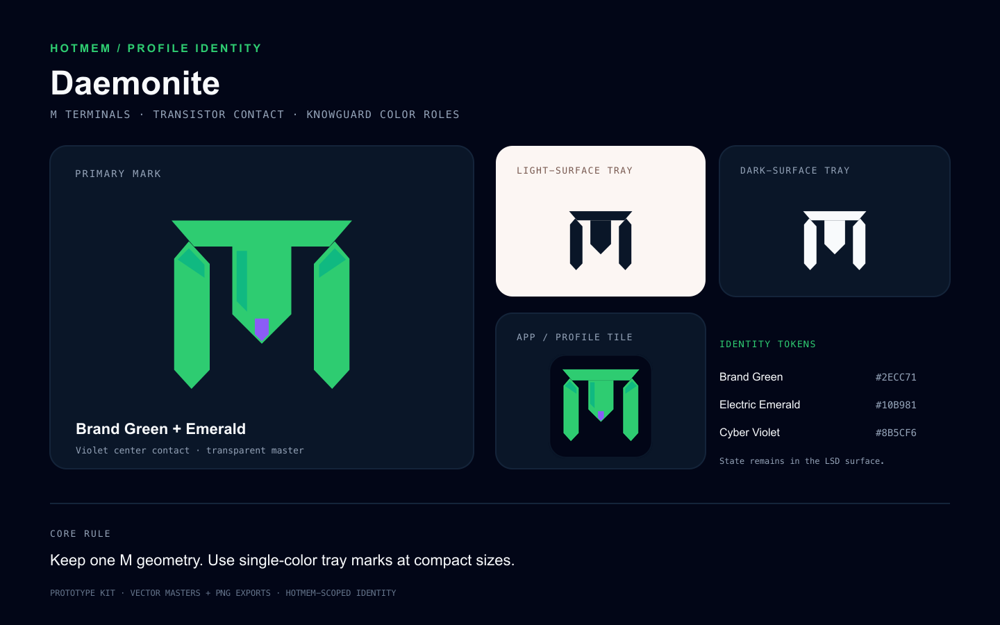

# HotMem Daemonite brand kit

The Daemonite mark carries forward the supplied M silhouette: a broad bridge
and three descending chip terminals. The central terminal is the transistor
contact. The kit keeps one geometry across the color, monochrome, app-icon, and
lockup variants.

## Assets

| File | Use |
| --- | --- |
| [daemonite-mark-primary.svg](daemonite-mark-primary.svg) | Full-color mark on a deep field |
| [daemonite-tray-dark.svg](daemonite-tray-dark.svg) | One-color `#0A1628` tray mark on light surfaces |
| [daemonite-tray-light.svg](daemonite-tray-light.svg) | One-color `#F8FAFC` tray mark on dark surfaces |
| [daemonite-app-icon.svg](daemonite-app-icon.svg) | Rounded dark tile for app and profile surfaces |
| [daemonite-lockup-dark.svg](daemonite-lockup-dark.svg) | Mark plus HotMem / Daemonite naming for dark fields |
| [references/owner-m-reference.png](references/owner-m-reference.png) | Owner-supplied visual reference |
| [references/generated-color-concept-v1.png](references/generated-color-concept-v1.png) | First generated full-color concept |
| [references/generated-mono-tray-exploration-v1.png](references/generated-mono-tray-exploration-v1.png) | Generated monochrome exploration |
| [references/generated-app-tile-exploration-v1.png](references/generated-app-tile-exploration-v1.png) | Generated app-tile exploration |

PNG tray exports: [dark 16](exports/tray/daemonite-tray-dark-16.png),
[dark 32](exports/tray/daemonite-tray-dark-32.png),
[dark 48](exports/tray/daemonite-tray-dark-48.png),
[dark 64](exports/tray/daemonite-tray-dark-64.png),
[light 16](exports/tray/daemonite-tray-light-16.png),
[light 32](exports/tray/daemonite-tray-light-32.png),
[light 48](exports/tray/daemonite-tray-light-48.png), and
[light 64](exports/tray/daemonite-tray-light-64.png).

App-icon PNG exports: [128](exports/app/daemonite-app-icon-128.png),
[256](exports/app/daemonite-app-icon-256.png), and
[512](exports/app/daemonite-app-icon-512.png). The remaining PNG exports are
[the primary mark at 256](exports/daemonite-mark-primary-256.png),
[the primary mark at 512](exports/daemonite-mark-primary-512.png), and
[the lockup at 1040](exports/daemonite-lockup-dark-1040.png). The overview
board is [daemonite-brand-board.png](daemonite-brand-board.png). The SVGs are
the color-accurate masters; generated reference PNGs are explorations.
[SHA256SUMS](SHA256SUMS) records the digest of every other file in this kit.

The earlier standalone inputs remain in HotMem's parent brand directory:
[owner M reference](../daemonite-m-tray-reference.png) and
[first color concept](../daemonite-m-tray-concept-v1.png). Copies are also
retained in `references/` above so this kit remains self-contained.

## KnowGuard / HotMem color roles

| Token | Hex | Mark use |
| --- | --- | --- |
| The Void | `#020617` | App-icon field |
| Dark Navy | `#0A1628` | Dark monochrome tray mark and quiet structure |
| Brand Green | `#2ECC71` | Primary Daemonite mark |
| Electric Emerald | `#10B981` | Small structural facets |
| Cyber Violet | `#8B5CF6` | Central transistor contact |
| Cool Grey | `#F8FAFC` | Light mark for dark surfaces |
| Slate-400 | `#94A3B8` | Secondary lockup label |

These are HotMem's documented KnowGuard identity colors, applied to this
HotMem profile mark. Mark color carries identity only; the planned Daemonite
interface communicates live daemon, memory, and connection state separately.
LSD Mini Player is the project selected to render that interface.

## Use

- Use the primary mark on `#020617` or `#0A1628` fields.
- For a compact tray rendering, use a single-color tray SVG and export at the
  platform's actual logical size and scale factor. Choose dark or light by the
  host surface; do not use color to indicate runtime state.
- The lockup uses Space Grotesk for the product name and JetBrains Mono for
  the profile label, matching the HotMem typography guide.
- Preserve the proportions and transparent clear space. Do not add glow,
  extra color accents, or a chip enclosure around the mark.

This is a local prototype kit. The target desktop platform, tray-template
behavior, and final approved exports remain open.
